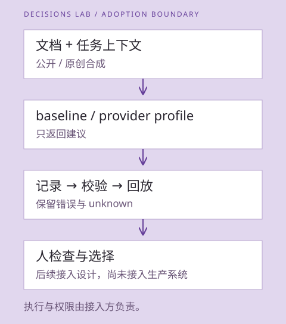

# 从实验接到自己的工作流

第一条值得接的路径是“新资料或变更 → 推荐下一步核对动作”。输入有限、建议可检查、反馈能回到实验，而且不必让模型直接接管文件、记忆或执行器。

想换一个入口，可以从[20 种玩法](playbook.md)选择 NPC 行为、互动叙事、阅读路径、素材整理或工具路由；每项都有现成项目和可检查的第一步。具体请求请结合[10-15 API 增量与原生示例](../research/2026-10-15/README.md)，不要把首页复制的通用任务 JSON 直接当成 provider 的请求体。

如果问题需要编号、日期或数值，先读[类型化输出](typed-values.md)与[10-20 Clairic 核查](../research/2026-10-20/README.md)。[实验题本与离线 CLI](../experiments/typed-values/README.md)可以准备请求、导入本地响应并回放字段／计算／预测评分；Clairic 的真实采集另走[显式开启的有界 collector](research-infrastructure.md)，没有生产执行接线。

## 输入只带这次判断需要的上下文

公共来源变化可以先由确定性代码筛出候选：URL、版本、diff 和依赖关系都适合精确匹配。之后再给模型一个简短任务上下文，询问下一步应该核对来源、比较 contract、结合实际调用阅读，还是先补信息。

来源命中只是候选关联。某个文档改了、某个模型被提到，都不能直接证明当前项目受影响。涉及“适不适用”的判断，必须让调用方提供当前依赖和目标；缺这些就保留缺口。

## 建议不自动变成操作

模型返回一个 action ID 和原生概率/置信度；代码先校验 contract，再呈现建议、原文位置与上下文。操作者选择采纳、改选或补充上下文。只有执行端自己的权限与前置条件允许时，后续工具才执行动作。

本仓库已实现 next-action 的合成输入到记录、重放、评估路径及需显式开启的 collector；typed-values 使用独立的离线导入与评分路径；[api-lab](../experiments/api-capabilities/README.md)另有规则编译、概率组合、视觉 criteria 的多问题离线请求／导入／重评，不自动进行网络采集。`research collect` 复用这些 retained requests，`research ledger/compare` 提供外层失败/重复/损失视图；规则 repair 是已实现的离线有限流程，主动取证与完整 typed DAG 尚未实现。上图右端的人类反馈和实际执行是**接入设计**，尚未接入任何生产系统。

## 采用顺序

### 取值以后，哪一步还需要模型

假设材料中同时有金额、日期和一句适用条件。提取器找到金额和日期，代码可以完成合计与日期差；只有剩下的语义关系需要模型判断。不要为一个已经能精确计算的阈值再调用 decision model。

提取会改变下游能看到的证据。比较三条路径：直接读完整材料；只读提取字段；读字段并能回看对应原文和条件。每条都用同一任务、标签和评分，记录完整成本。字段版如果漏了“仅对新版生效”，下游做出合法而错误的判断，是一个应该被看见的失败。

分阶段评分能定位原因：检索是否提供了关键证据、字段是否对应正确实体、计算是否正确、最后是否采用了适用规则。缺失字段保持缺失；预测单独标识，不能并入“已经知道的事实”。这些是本项目的接入设计，尚无优于直接调用的实测结论。

### 从实验到使用

1. **离线回放**：公开/合成材料，用同一任务定义比较 baseline 与模型。先找模型能增益、也可能误导的地方。
2. **旁路建议**：经授权后，真实工作流继续原样运行，模型只给建议；记录人为何改选。私人上下文和记录留在接入方自己的边界内。
3. **有限采用**：仅对已验证、低代价、可撤回的动作考虑自动化。错误代价、回退、责任人和取消方式先明确。

目前处于第一阶段，有限公开合成推理的协议与观察见[原生 provider 实验](../experiments/provider-pilot/README.md)。没有进入私人工作流旁路或生产采用；不要直接把公共 benchmark 分数换成后台行动权限。

## 相关项目怎样用

[项目地图](projects.md)按接线、开放模型、运行时、工作流机制和评估证据分组。优先读官方客户端确定 transport/contract；从工作流项目学习一个具体机制；再拿本地任务验证。是否安装、自托管或依赖某个项目，应基于确切 revision、许可、硬件与维护成本另作判断。列入地图不等于采用推荐。

我们暂不建立通用万能 router、统一 provider confidence 或自主记忆写入层。next-action 保留两个明确的原生 Choice profile；typed-values 通过独立记录解释字段、计算和预测错误，网络采集另走[有界 collector](research-infrastructure.md)，默认不调用。api-lab 的 manifest 保留当时原生请求与本地 rubric，只有 body 和所需 header 属于模型请求；导入和重评不执行生成代码或外部动作。api-lab 另支持 Cloudflare Clef／Clef Flash 的账号固定 URL 加 Body 短 selector，以及 OpenRouter 原生 `/api/alpha/decisions`；后者默认锁定目录中的零价免费精确 route，不自动回退到付费模型。Cloudflare 外层成功与 `result` 内的 typed answer 分开校验，路径 model ID、Body selector、实际 provider 与返回 model 分别进入证据或账本。视觉题仍只走 Jev，不能把 OpenRouter 的图像传输能力当作同构 criteria 契约。进一步扩展由具体用例推动。
